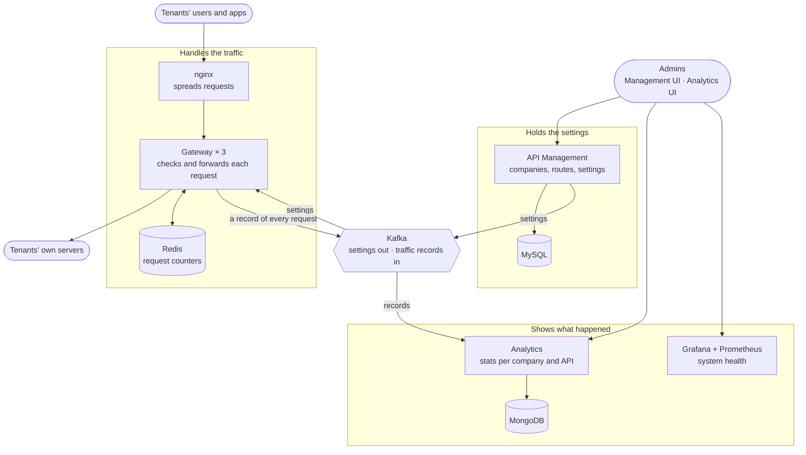

# Gatekeeper

Gatekeeper is an **API gateway for many companies at once**. A company (we call it a *tenant* or *organization*)
tells Gatekeeper which of its APIs should be reachable. Its users then call those APIs through Gatekeeper, which:

- lets through only the requests the company configured, and only from users authenticated by the company's
  configured identity provider (login service),
- stops any single user or API from being flooded,
- keeps working when parts of the platform fail,
- and records requests asynchronously for analytics, so companies can see how their APIs are doing (with a small
  risk of losing some records while Kafka is down).

It is built from three small Java services that talk to each other through Kafka (a message queue), and the whole
system starts with one command.

> The two web UIs in `ui/` are simple, AI-generated front ends for the APIs. The backend services are the project.

---

## Contents
1. [How it works](#1-how-it-works)
2. [What you need](#2-what-you-need)
3. [Start it](#3-start-it)
4. [Try it: a tenant from scratch](#4-try-it-a-tenant-from-scratch)
5. [Tests](#5-tests)
6. [Load test](#6-load-test)
7. [Important design decisions](#7-important-design-decisions)
8. [Known issues](#8-known-issues)
9. [Settings](#9-settings)
10. [Folder layout](#10-folder-layout)

---

## 1. How it works



There are three services:

| Service | What it does | Stores data in |
|---|---|---|
| **API Management** (`api-management-service`) | Where admins set things up: companies, their admins, their API routes, which login provider to trust. Keeps a history of every settings change and can roll back. | MySQL |
| **Gateway** (`smart-gateway-service`) | Receives every request from tenants' users, checks it, and forwards it to the tenant's own server. Runs as 3 copies behind nginx so one can fail. | Redis (counters) |
| **Analytics** (`analytic-service`) | Stores a record of every request and turns it into dashboards: traffic, errors, response times. | MongoDB |

**What happens when a user calls an API**
1. The request reaches nginx, which hands it to one of the three gateways.
2. The gateway checks that this exact method and path is one the company configured. Anything else is rejected.
3. It checks the user's login token. Each company uses its own login provider (for example Auth0 or Okta); the
   gateway only accepts tokens that provider signed.
4. It checks the limits: how many requests this API may receive per minute, and how many one user may send.
5. It forwards the request to the company's server and returns the answer.
6. It writes a short record of the request to Kafka. Analytics picks it up from there.

**What happens when an admin changes a setting**
1. The admin saves a change in API Management (for example a new route).
2. API Management gives the company's settings a new version number and sends the complete new settings to Kafka.
3. All three gateways pick it up and use it right away, no restart needed (measured: in under a tenth of a second).

Because the gateways get their settings from Kafka and keep a copy in memory, they keep serving traffic even
when API Management is down.

**Who can do what**

| Role | Can |
|---|---|
| Platform admin | Create, suspend and reactivate companies; create their admins; see every company's analytics and the system-health dashboard |
| Tenant admin | Only their own company: routes, login-provider settings, settings history and rollback, their own analytics |
| Tenant's users | Call their company's APIs through the gateway, logged in through the company's own login provider |

---

## 2. What you need

- **Docker with Compose**: Docker Desktop on Windows or macOS, or Docker Engine with the Compose plugin on Linux.
- **At least 8 GB of RAM**, with Docker allowed to use at least 4 GB (Docker Desktop → Settings → Resources).
- **These ports free:** 8080, 8081, 8082, 5173, 5175, 3000, 9090, 6379, 9092.
- **To follow section 4:** `curl` and a terminal like bash (on Windows, Git Bash works).
- **To run the load test:** PowerShell (built into Windows; called `pwsh` on macOS and Linux).

You do **not** need Java, Maven or Node installed. Everything is built inside Docker.

---

## 3. Start it

```bash
git clone https://github.com/Nikhil2409/GateKeeper.git gatekeeper
cd gatekeeper

docker compose up -d --build
```

The first start builds everything and takes 5 to 10 minutes. Later starts take about a minute.

**Check that it's running:**
```bash
docker compose ps                              # every line should say "Up" (some also "healthy")
curl http://localhost:8080/_gateway/health     # should answer {"status":"UP", ...}
```

**Open it:**

| Address | What | Log in with |
|---|---|---|
| http://localhost:5173 | Management UI | `platform-admin` / `admin-pass-123` |
| http://localhost:5175 | Analytics UI (platform admins also get "System metrics") | the same |
| http://localhost:8080 | The gateway (where tenants' users send requests) | |
| http://localhost:8081 | API Management's API | |
| http://localhost:8082 | Analytics' API | |

> **These are development credentials for local demonstration only.** Change them (see "Changing passwords"
> below) before exposing the system beyond your own machine. These local demo credentials and default secrets are
> configured for development only; how the services authenticate and authorize requests is described in sections
> 1 and 7. Every demo default (admin password, database password, Grafana password, and the `dev` profile that adds the
> example companies) lives in `docker-compose.yml`, which is meant for local use. A real deployment must supply
> its own values and must not use the `dev` profile.

On first start the system also adds a few **example companies** (acme, globex, ...) so the UIs aren't empty. Their
admins log in as `<name>-admin` / `demo-pass-123`, for example `acme-admin`. Their routes point at made-up servers, so
calling them through the gateway stops at the login check. Section 4 sets up a company that works end to end.

**Stop it** with `docker compose down`. Your data is kept; `docker compose down -v` deletes it too.

**Changing passwords (optional).** Every setting has a working default. To change the defaults, copy
`.env.example` to `.env` and edit it; the file explains each value. Never commit `.env`.

---

## 4. Try it: a tenant from scratch

This walks through the whole flow with `curl`: create a company, give it an admin, set up one API route, then call
it as a user and look at the stats.

To call the route you need a logged-in user, and that needs a login provider. The load-test kit includes a small
test login provider, so start the system with it once:

```bash
docker compose -f docker-compose.yml -f loadtest/docker-compose.loadtest.yml up -d

# small helper that pulls one field out of a JSON answer
json() { sed -E "s/.*\"$1\":\"?([^\",}]+)\"?.*/\1/"; }
```
This adds the test login provider to the running system and restarts only the stand-in test server (so it can
serve the provider's public keys); everything else keeps running. The provider's files live in the Docker volume
`gatekeeper_loadtest-idp` (the project name `gatekeeper` comes from `docker-compose.yml`; if you set
`COMPOSE_PROJECT_NAME` yourself, use `<your name>_loadtest-idp` in step 3).

**Step 1. As the platform admin, create a company and its admin**
```bash
ADMIN=$(curl -s http://localhost:8081/auth/login -H 'Content-Type: application/json' \
  -d '{"username":"platform-admin","password":"admin-pass-123"}' | json accessToken)

ORG_ID=$(curl -s http://localhost:8081/api/platform/organizations -H "Authorization: Bearer $ADMIN" \
  -H 'Content-Type: application/json' -d '{"name":"Readme Shop","slug":"readme-shop"}' | json id)

curl -s http://localhost:8081/api/platform/tenant-admins -H "Authorization: Bearer $ADMIN" \
  -H 'Content-Type: application/json' \
  -d "{\"username\":\"readme-shop-admin\",\"password\":\"readme-pass-123\",\"organizationId\":$ORG_ID}"
```
`slug` is the company's short name. It becomes the start of its URLs: `http://localhost:8080/readme-shop/...`.

**Step 2. As the company's admin, choose a login provider and add a route**
```bash
TENANT=$(curl -s http://localhost:8081/auth/login -H 'Content-Type: application/json' \
  -d '{"username":"readme-shop-admin","password":"readme-pass-123"}' | json accessToken)

# accept user tokens from the test login provider
curl -s -X PUT http://localhost:8081/api/tenant/token-settings -H "Authorization: Bearer $TENANT" \
  -H 'Content-Type: application/json' \
  -d '{"issuer":"http://wiremock:8080/loadtest-idp","jwksUri":"http://wiremock:8080/loadtest-idp/jwks.json","audience":"loadtest-api"}'

# GET /readme-shop/fast is forwarded to the test server, at most 60 requests per minute
curl -s http://localhost:8081/api/tenant/routes -H "Authorization: Bearer $TENANT" -H 'Content-Type: application/json' \
  -d '{"routeId":"products","name":"Products","pathPattern":"/fast","targetBaseUrl":"http://wiremock:8080",
       "targetPathPrefix":"","allowedMethods":["GET"],"requestsPerMinute":60,"responseTimeoutMs":2000,
       "idempotencyEnabled":false,"headerRules":[],"allowedHeaders":[]}'
```

**Step 3. As a user, call the route through the gateway**
```bash
# a login token for a test user, from the test login provider
USER_TOKEN=$(docker run --rm -v gatekeeper_loadtest-idp:/idp node:22-alpine \
  node -e "console.log(require('/idp/tokens.json').tokens[0])")
# on Windows Git Bash, put MSYS_NO_PATHCONV=1 in front of "docker run"

curl -i http://localhost:8080/readme-shop/fast -H "Authorization: Bearer $USER_TOKEN"
```

What you should see:

| Request | Answer | Why |
|---|---|---|
| The call above | `200` and `{"ok":true}` | allowed and forwarded |
| The same without the `Authorization` header | `401` | no logged-in user |
| `/readme-shop/nope` | `404` | not a route the company configured |
| More calls than the user's quota within one minute | `200` until the quota is used up, then `429 Too Many Requests` | one user may use only a tenth of the route's 60 per minute, so 6 per minute |

```bash
for i in $(seq 65); do curl -s -o /dev/null -w "%{http_code}\n" http://localhost:8080/readme-shop/fast \
  -H "Authorization: Bearer $USER_TOKEN"; done | sort | uniq -c
```
In our run this printed `5 200` and `60 429`: the call above had already used one of the six. These counts are an
example, not guaranteed output: the split depends on how many calls you made before, and the loop only counts
status codes, so a run that crosses into the next minute gets a fresh quota partway through.

**Step 4. As the company's admin, look at the stats** (wait about 5 seconds first: the numbers are updated in the
background, see design decision 6)
```bash
curl -s "http://localhost:8082/analytics/summary?range=1h" -H "Authorization: Bearer $TENANT"
curl -s "http://localhost:8082/analytics/routes?range=1h"  -H "Authorization: Bearer $TENANT"
```
In our run, a query made immediately showed 54 requests; 7 seconds later it showed 66, exactly the calls made. You
can also log in to the Analytics UI as `readme-shop-admin` / `readme-pass-123`.

**Clean up (optional).** Companies are never deleted, only suspended:
```bash
curl -s -X PATCH http://localhost:8081/api/platform/organizations/$ORG_ID/suspend -H "Authorization: Bearer $ADMIN"
```

---

## 5. Tests

**There are no automated tests yet.** The project has no unit tests, integration tests or CI pipeline. So far,
behaviour has been checked by hand with scripts like the one above and by the load test (section 6). The load test
measures behaviour under traffic; it does **not** replace unit or integration tests and doesn't protect against
regressions.

This is the project's clearest gap. The next engineering milestone, in priority order:
1. Tenant isolation and authorization tests (a tenant admin can never read or change another company's data).
2. Configuration version ordering and rollback tests (newer versions win, rollback publishes a new version).
3. Idempotency tests, including concurrent duplicates and Redis failure.
4. Rate-limit accuracy across multiple gateway instances.
5. Analytics ingestion and rollup tests (rollups match the raw events, redelivery doesn't double-count).
6. A CI workflow that runs the regression suite on every push.

To check that everything builds:
```bash
docker compose build
```

To check that the whole system works end to end (about 3 minutes):
```powershell
.\loadtest\run.ps1 -Test baseline
```

---

## 6. Load test

The load test sends a lot of traffic through the system with [k6](https://k6.io) and measures what happens,
including when parts of the system are switched off on purpose. Everything for it is in `loadtest/`; none of it is
part of the product itself.

### How it works
- **It sets up its own test companies** through the normal APIs each time: `lt-shop` (gets 50% of the traffic),
  `lt-payments` (30%) and `lt-media` (20%). Each has the same five routes. Behind them is a stand-in server
  (WireMock) that answers instantly, after 200 ms, or always with an error, depending on the route.
- **It brings its own login provider**, which hands out 200 test users.
- **It waits until all three gateways are ready** before measuring.
- **For the outage tests** it stops one part of the system 60 seconds in and starts it again 60 seconds later.

### The tests

| Test | What it does | What it shows |
|---|---|---|
| `baseline` | the same requests straight to the server, then through the gateway | how much time the gateway adds |
| `throughput` | increases the traffic step by step until errors or slow answers appear | how much traffic it can handle |
| `scaling` | the same with one gateway, then with three | capacity of one gateway |
| `ratelimit` | sends twice the allowed number of requests for 3 minutes | rate-limit accuracy across three gateways |
| `hotreload` | changes a route every 10 seconds under traffic | whether setting changes cause errors |
| `failover` | stops one gateway mid-test | what happens when a gateway dies |
| `chaos` | stops Kafka, Redis and API Management one at a time | what happens when each dependency dies |

### Run it
```powershell
.\loadtest\run.ps1                                     # all tests, about 40 minutes
.\loadtest\run.ps1 -Test throughput -MaxRate 1000      # one test
.\loadtest\run.ps1 -Test chaos -ChaosServices redis    # one outage
```
Results are saved in `loadtest/results/`: a summary and the raw measurements for each test, plus `machine.txt`
describing the computer. The test companies' traffic also shows up in the Analytics UI. Log in as `lt-shop-admin`,
`lt-payments-admin` or `lt-media-admin` with `loadtest-pass-123`.

### Results

> **⚠ These numbers depend on the machine.** They were measured on one laptop: AMD Ryzen 5 5600H (6 cores),
> 7.3 GB RAM, Windows 11, with Docker allowed 3.5 GB. The test tool and the whole system shared that laptop, and it
> was short on memory. Expect better throughput and response times on a bigger machine. The functional outcomes
> below (limit accuracy, errors, behaviour during outages) were observed in these test runs, but results may vary
> with hardware, timing and resource contention. The measurements have not yet been reproduced on a larger
> machine.

**How much time the gateway adds** (300 requests per second, no errors)

| | half of requests faster than | 95% faster than | 99% faster than |
|---|---|---|---|
| Straight to the server | 0.4 ms | 0.7 ms | 2.1 ms |
| Through the gateway | **2.5 ms** | **4.2 ms** | **6.3 ms** |

At 300 requests per second, the path through the gateway measured 2.5 ms (half of requests), 4.2 ms (95%) and
6.3 ms (99%), compared with 0.4 ms, 0.7 ms and 2.1 ms when calling the server directly. These are two separately
measured distributions, so their difference is only an indication of what the gateway's checks cost, not an exact
per-request overhead. Right after the gateways start, the first few seconds are slower (the slowest 1% around
100 ms) while they warm up. These results are specific to the test environment.

**Capacity and accuracy**

| Test | Result |
|---|---|
| Traffic through 3 gateways | **1,000 requests per second** with no errors (the highest rate tried on this laptop) |
| One gateway on its own | handles about **550-600 requests per second** on this laptop |
| Limit accuracy (limit 600 per minute, across 3 gateways) | **1,803 let through for 1,800 expected (0.17% off)** |
| Changing a route every 10 seconds under traffic | **0 failed requests**; every gateway had the change within **0.07 seconds** |
| Analytics dashboards with 864,000 stored requests | load in **0.02-0.06 seconds** |

**When something breaks** (200 requests per second; the deliberately failing route left out)

| Switched off for 60 s | Observed impact |
|---|---|
| One of the three gateways | The other two continued serving; **0.18%** of requests failed while the stopped one restarted. |
| API Management | No request impact observed during the test. Gateways kept serving from their own copy of the settings; settings could not be changed meanwhile. |
| Kafka | No request failures observed; about **2%** of traffic records for analytics were lost. |
| Redis | No request failures observed; rate limiting degraded to per-gateway counting and the gateway's idempotency check was bypassed, so the company's server must deduplicate (see decision 4). |

These are observations from single test runs on the machine above, not guarantees.

---

## 7. Important design decisions

Each of these was a deliberate choice; the full reasoning is kept in the project's design log.

1. **The gateways never ask API Management for anything.** Settings are pushed to them through Kafka, always the
   company's complete settings with a version number, and a gateway only takes a newer version. So messages
   arriving twice or out of order do no harm, a restarted gateway catches up on its own, and API Management can be
   down without affecting traffic.
2. **Rolling back creates a new version.** It doesn't send an "older" one. Going back to version 4 publishes the
   settings of version 4 as, say, version 9. A delayed or duplicated message can therefore never undo a later
   change. The last 5 versions are kept, and each can be previewed and compared before rolling back.
3. **Everything is blocked unless it was set up.** Only configured paths and methods go through, only allowed
   headers are passed on, and a route can never point at the platform's own internal services.
4. **Safe retries for payments and orders (idempotency).** A user's app may send the same "place order" request
   twice, for example after a dropped connection. On routes marked as idempotent, the app sends a unique key with
   each request. The gateway recognises a repeat and returns the first answer instead of placing the order again,
   and the company's own server is expected to check the key too: turning idempotency on for a route means the
   company promises to deduplicate on that key. During a Redis outage the gateway bypasses its own check so
   requests can continue. The company's server must still deduplicate using the `Idempotency-Key`; otherwise
   duplicate operations may occur while Redis is down.
5. **When something it depends on breaks, the gateway keeps serving.** If Kafka is down, records are held and, if
   needed, dropped; requests never wait for them. If Redis is down, the gateway stops calling it right away
   instead of waiting each time, and counts limits on its own. If a company's server keeps failing, the gateway
   pauses calls to it for 30 seconds (a *circuit breaker*) instead of piling on more requests.
6. **Dashboards read pre-calculated numbers.** Every five seconds a background job recomputes the per-minute
   summaries for the minutes that received new events. Dashboards query these summaries instead of scanning all
   raw records. Recomputing a minute (rather than adding to a running total) avoids double-counting when a minute
   is rolled up again and lets late-arriving events be included. Each raw event is stored with the gateway's request
   id as its MongoDB `_id` (always unique) and saved as an upsert, so a Kafka redelivery of the same event replaces
   the stored record instead of adding a second one. Counts are exact relative to the stored events.
   Response-time percentiles are estimates from latency buckets about 20% wide: in our tests they were within
   about 10% of the exact values, but the error depends on how the traffic's response times are spread. The
   numbers are a few seconds old.
7. **One login for everything.** API Management issues the login tokens; Analytics and Grafana check them with API
   Management's public key. Only platform admins get Grafana. Tenants get their own live view instead, because
   Grafana can't stop one company from seeing another's numbers.
8. **A company's data is separated by the login token.** A tenant admin's company is read from their token, never
   from the URL, so they can't ask for another company's data.

---

## 8. Known issues

**Found by the load test and already fixed**

| Problem | Fix |
|---|---|
| When one company's API kept failing, nginx wrongly treated all three gateways as broken, so **every** company got errors (about 52% of requests failed). | nginx now only skips a gateway it can't reach at all |
| When Redis was down, every order or payment request failed, and every request waited half a second first. | the gateway now stops calling Redis right away and carries on without it |
| Dashboards took 5 to 19 seconds to load once there was a lot of traffic data. | dashboards now read pre-calculated per-minute totals |
| The analytics database (MongoDB) ran out of memory under load, and its health check timed out. | memory limit raised from 320 MB to 512 MB, health-check timeout from 5 s to 10 s |

**Still open**

| Issue | Details |
|---|---|
| No automated tests or CI yet | the next milestone: regression tests for isolation, config ordering and rollback, idempotency, limits and analytics, then CI (section 5) |
| A gateway that is restarting returns errors for a few seconds | 0.18% of requests in the test |
| When Kafka goes down, about 2% of traffic records for analytics are lost | a deliberate trade-off: losing some stats is better than slowing users down |
| Short slowdowns right after a stopped part restarted | most likely the test laptop running out of memory; to be checked on a bigger machine |
| Response times on the dashboards are estimates | within about 10% in our tests; the error depends on the traffic; request counts are exact |
| While Redis is down, limits are approximate and repeated orders aren't caught by the gateway | the company's server must deduplicate them; if it doesn't, duplicates can happen (decision 4) |
| No API keys for machine-to-machine callers | they use tokens from the company's login provider instead |
| The UIs only work on the machine running Docker | their API addresses (`localhost`) are fixed when they're built |

---

## 9. Settings

| What | Default |
|---|---|
| Login tokens stay valid for | 15 minutes |
| Settings versions kept for rollback | 5 |
| How much one user may use of a route's limit | a tenth |
| Limits are counted per | minute, shared by all gateways |
| A failing company server is paused | after half of its last 20 calls failed, for 30 seconds |
| A failed request is retried | up to 3 times, only when that's safe, within the route's time limit |
| A stored answer for repeated orders is kept | 24 hours |
| Dashboard numbers are updated every | 5 seconds |
| Traffic records are kept | 15 days |
| Memory the whole system may use | about 2.4 GB in total |

Passwords and other changeable values are in [`.env.example`](.env.example). The keys that sign login tokens are
created automatically on first start and never leave the Docker volume they live in.

---

## 10. Folder layout

```
api-management-service/   settings service (Java 21, Spring Boot, MySQL)
smart-gateway-service/    gateway (Java 21, Spring Boot, Redis)
analytic-service/         analytics (Java 21, Spring Boot, MongoDB)
ui/                       the two web UIs (React)
docker/                   nginx, Prometheus, Grafana and test-server settings
loadtest/                 the load test: k6 scripts, test login provider, run.ps1
docker-compose.yml        starts the whole system
.env.example              changeable passwords and settings
```
