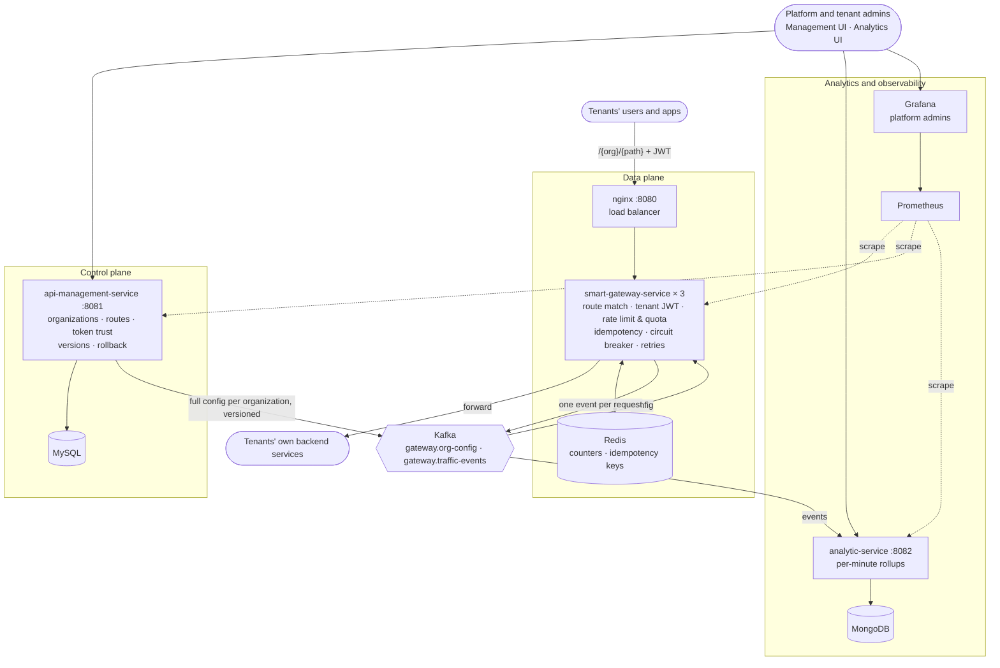

# Gatekeeper

A multi-tenant API gateway platform. Organizations (tenants) register their backend APIs; the gateway checks,
limits and forwards their users' traffic, survives its dependencies going down, and records every request for
analytics. Three Spring Boot services, Kafka between them, the whole system in one `docker compose up`.

- **Control plane** (`api-management-service`): organizations, tenant admins, routes, token trust, versioned
  configuration with history and rollback.
- **Data plane** (`smart-gateway-service`, 3 instances behind nginx): deny-by-default routing, tenant JWT
  verification, rate limits and per-user quotas, idempotency, circuit breakers, safe retries, hot configuration
  reload. Never calls the database or the control plane.
- **Analytics** (`analytic-service`): traffic stats for platform and tenant admins, live per-route performance.
- **Observability**: Prometheus + Grafana (platform admins), correlation id across every hop.

Load-tested with k6, including runs that stop a gateway instance, Kafka, Redis and api-management under load; the
test found and fixed three real bugs (see [Known issues](#known-issues-and-limitations)).

> The two React UIs (`ui/`) are thin, AI-generated clients for the APIs. The backend services are the project.

---

## Contents
- [Architecture](#architecture)
- [Prerequisites](#prerequisites)
- [Setup and startup](#setup-and-startup)
- [Sample requests](#sample-requests)
- [Building and tests](#building-and-tests)
- [Load testing](#load-testing)
- [Critical design choices](#critical-design-choices)
- [Known issues and limitations](#known-issues-and-limitations)
- [Configuration reference](#configuration-reference)
- [Repository layout](#repository-layout)

---

## Architecture



The gateways sit on two Docker networks: the platform network (everything above) and a separate network for tenant
backends. Routes may never target the platform network, so a tenant can't point a route at Redis or MySQL.

**How a configuration change travels.** A tenant admin saves a route → api-management bumps the organization's
version and, inside the same transaction, builds the organization's *complete* configuration → after commit it is
published to the compacted Kafka topic `gateway.org-config`, keyed by organization → every gateway instance applies
it if its version is newer (measured: on all 3 instances within ~61 ms, zero failed requests). On startup a gateway
rebuilds its whole registry from the topic and answers `503` until it has caught up.

**How a tenant request travels.** `nginx` → a gateway → deny-by-default route match (`METHOD` + exact path
template) → the tenant's user token is verified against *that tenant's* identity provider (JWKS) → per-user quota
and route rate limit (Redis, shared by all instances) → idempotency check for idempotent routes → forward with a
circuit breaker per route and safe retries → one traffic event to Kafka (queued, never slows the request) →
analytics stores it in MongoDB.

**Who can do what.**

| Role | Can |
|---|---|
| Platform admin | Create/suspend/activate organizations, create tenant admins, Kafka and gateway health views, all analytics, Grafana |
| Tenant admin | Own organization only: routes, token settings, configuration history and rollback, own analytics and live performance |
| Tenant's users | Call the organization's routes through the gateway with a JWT from the organization's own identity provider |

---

## Prerequisites

| | |
|---|---|
| Docker | Docker Desktop (Windows/macOS) or Docker Engine + Compose v2 (Linux). Free for personal use. |
| Memory | **8 GB RAM minimum**, Docker VM with **at least 4 GB** (Docker Desktop → Settings → Resources). The stack caps itself at ~2.4 GB; more is better for the load test. |
| Ports free | `8080 8081 8082 5173 5175` (all interfaces), `3000 9090 6379 9092` (127.0.0.1 only). MySQL and MongoDB publish no ports, so local installs don't clash. |
| For sample requests | `curl` and a POSIX shell (Git Bash on Windows works) |
| For the load test | PowerShell (built into Windows; `pwsh` on macOS/Linux). k6 itself runs in Docker. |

No JDK, Maven or Node is needed: every image is built inside Docker.

---

## Setup and startup

```bash
git clone <this repository> gatekeeper
cd gatekeeper

# optional: every setting has a working default; copy only to change passwords
cp .env.example .env

docker compose up -d --build      # first build: 5-10 minutes; afterwards ~1 minute
docker compose ps                 # every container Up / healthy
curl http://localhost:8080/_gateway/health   # {"status":"UP",...} once configuration is loaded
```

Stop with `docker compose down` (data stays in named volumes; `down -v` wipes it).

On first start api-management **generates its RS256 signing key pair** into a Docker volume (no key is ever in the
repository or an image), Flyway creates the schema, and the `dev` profile loads **sample organizations** (acme,
globex, initech, umbrella, stark, wayne) so the UIs have something to show. Their routes point at made-up hosts
and their identity providers don't exist, so calls to them through the gateway stop at the token check (`401`).
The [sample requests](#sample-requests) create a working tenant.

| URL | What | Login |
|---|---|---|
| http://localhost:5173 | Management UI | `platform-admin` / `admin-pass-123`; sample tenants `<slug>-admin` / `demo-pass-123` |
| http://localhost:5175 | Analytics UI (System metrics = Grafana for platform admins) | same accounts |
| http://localhost:8080 | Gateway (nginx → 3 instances) | tenant user JWTs |
| http://localhost:8081 | api-management API | |
| http://localhost:8082 | analytics API | |
| http://localhost:3000 | Grafana (opened through the analytics UI) | platform admin JWT |
| http://localhost:9090 | Prometheus | |

The UI images bake in `localhost` API addresses, so the UIs work from the machine running Docker; the APIs are
reachable from your network on the published ports.

---

## Sample requests

A complete tenant end to end: organization → tenant admin → token trust → route → a user calling it through the
gateway → analytics. The user token comes from the small test identity provider that ships with the load test
(`loadtest/idp`), so start the stack with its override once:

```bash
docker compose -f docker-compose.yml -f loadtest/docker-compose.loadtest.yml up -d
json() { sed -E "s/.*\"$1\":\"?([^\",}]+)\"?.*/\1/"; }   # tiny JSON field extractor, avoids needing jq
```

**1. Platform admin: log in, create an organization and its tenant admin**
```bash
ADMIN=$(curl -s localhost:8081/auth/login -H 'Content-Type: application/json' \
  -d '{"username":"platform-admin","password":"admin-pass-123"}' | json accessToken)

ORG_ID=$(curl -s localhost:8081/api/platform/organizations -H "Authorization: Bearer $ADMIN" \
  -H 'Content-Type: application/json' -d '{"name":"Readme Shop","slug":"readme-shop"}' | json id)

curl -s localhost:8081/api/platform/tenant-admins -H "Authorization: Bearer $ADMIN" \
  -H 'Content-Type: application/json' \
  -d "{\"username\":\"readme-shop-admin\",\"password\":\"readme-pass-123\",\"organizationId\":$ORG_ID}"
```

**2. Tenant admin: trust an identity provider, add a route**
```bash
TENANT=$(curl -s localhost:8081/auth/login -H 'Content-Type: application/json' \
  -d '{"username":"readme-shop-admin","password":"readme-pass-123"}' | json accessToken)

curl -s -X PUT localhost:8081/api/tenant/token-settings -H "Authorization: Bearer $TENANT" \
  -H 'Content-Type: application/json' \
  -d '{"issuer":"http://wiremock:8080/loadtest-idp","jwksUri":"http://wiremock:8080/loadtest-idp/jwks.json","audience":"loadtest-api"}'

curl -s localhost:8081/api/tenant/routes -H "Authorization: Bearer $TENANT" -H 'Content-Type: application/json' \
  -d '{"routeId":"products","name":"Products","pathPattern":"/fast","targetBaseUrl":"http://wiremock:8080",
       "targetPathPrefix":"","allowedMethods":["GET"],"requestsPerMinute":60,"responseTimeoutMs":2000,
       "idempotencyEnabled":false,"headerRules":[],"allowedHeaders":[]}'
```

**3. A user calls the route through the gateway**
```bash
USER_TOKEN=$(docker run --rm -v gatekeeper_loadtest-idp:/idp node:22-alpine \
  node -e "console.log(require('/idp/tokens.json').tokens[0])")
# Git Bash on Windows: prefix the docker command with MSYS_NO_PATHCONV=1

curl -i localhost:8080/readme-shop/fast -H "Authorization: Bearer $USER_TOKEN"
# HTTP/1.1 200, X-Correlation-Id: ..., {"ok":true}

curl -s -o /dev/null -w "%{http_code}\n" localhost:8080/readme-shop/fast          # 401: no token
curl -s -o /dev/null -w "%{http_code}\n" localhost:8080/readme-shop/nope \
  -H "Authorization: Bearer $USER_TOKEN"                                           # 404: not a configured route
for i in $(seq 65); do curl -s -o /dev/null -w "%{http_code}\n" localhost:8080/readme-shop/fast \
  -H "Authorization: Bearer $USER_TOKEN"; done | sort | uniq -c
# 6 x 200, the rest 429: one user may use a tenth of the route's 60/min (per-user quota), the rest QUOTA_EXCEEDED
```

**4. The tenant's analytics (numbers are a few seconds behind, see design choice 7)**
```bash
curl -s "localhost:8082/analytics/summary?range=1h" -H "Authorization: Bearer $TENANT"
curl -s "localhost:8082/analytics/routes?range=1h" -H "Authorization: Bearer $TENANT"
curl -s "localhost:8082/analytics/live/routes" -H "Authorization: Bearer $TENANT"   # from Prometheus
```

**5. Optional: tidy up** (organizations are never hard-deleted)
```bash
curl -s -X PATCH localhost:8081/api/platform/organizations/$ORG_ID/suspend -H "Authorization: Bearer $ADMIN"
```

Other useful endpoints: `GET /api/tenant/configuration/versions` (history), `GET .../versions/{v}` (preview + diff),
`POST .../versions/{v}/rollback`, `GET /api/platform/kafka`, `GET localhost:8080/_gateway/status`,
`GET localhost:8081/.well-known/jwks.json`.

---

## Building and tests

```bash
# compile and package one service (uses the Maven wrapper; needs JDK 21 locally)
cd smart-gateway-service && ./mvnw -q package -DskipTests

# or build every image without a local JDK
docker compose build
```

**Automated tests: not yet written.** The repository currently has **no unit or integration test suite and no CI**.
Behaviour was verified by scripted end-to-end checks during development and by the k6 load test below. A
Testcontainers-based suite (MySQL, MongoDB, Redis, Kafka) and a GitHub Actions pipeline are the next planned step.

The load test is the executable verification today:

```powershell
.\loadtest\run.ps1 -Test baseline     # ~3 minutes, a quick check that the whole stack works end to end
```

---

## Load testing

### Methodology
Everything lives in `loadtest/` and is layered over the main compose file; none of it is part of the product.

- **Test tenants are created through the product's own APIs** at the start of every run (no seed data): three
  organizations (`lt-shop` 50% of traffic, `lt-payments` 30%, `lt-media` 20%), each with a tenant admin
  (`<slug>-admin` / `loadtest-pass-123`), token settings and five routes, all backed by WireMock:
  `fast`, `slow` (200 ms), `fail` (always 500), `limited` (600/min), `orders` (idempotent POST).
- **Their users' tokens** come from `loadtest-idp`, a one-shot container that generates an RSA key, publishes its
  JWKS through WireMock and mints 200 user tokens. k6 runs in Docker on both networks.
- **Every run waits** until all three gateways serve the tenants and warms their key caches before measuring.
- **Outages** are injected by `run.ps1`: the component is stopped 60 s into the measured part and started 60 s later.
- **Results** go to `loadtest/results/` (gitignored): a k6 summary (`.json`) and per-request samples (`.csv.gz`)
  per run, a Prometheus snapshot per outage run, `machine.txt` with the hardware. The test tenants' traffic also
  shows in the analytics UI and Grafana like any tenant's.

| Test | What it does | Measures |
|---|---|---|
| `baseline` | 300 req/s straight to the backend, then a 15 s warm-up, then 300 req/s through nginx + gateway | latency the gateway adds |
| `throughput` | rate climbs in 8 steps to `-MaxRate`, stops itself at >1% errors or p99 >500 ms | highest stable req/s |
| `scaling` | throughput against one instance directly, then three behind nginx | per-instance capacity |
| `ratelimit` | 2x the route limit for exactly 3 clock minutes, 200 users | rate-limit accuracy across instances |
| `hotreload` | a route changed every 10 s under 200 req/s | failed requests, propagation time |
| `failover` | 200 req/s mixed traffic, `smart-gateway-2` stopped mid-run | behaviour without an instance |
| `chaos` | same, stopping `kafka`, `redis`, `api-management-service` one at a time | failure modes |

```powershell
.\loadtest\run.ps1                                   # everything, ~40 minutes
.\loadtest\run.ps1 -Test throughput -MaxRate 1000    # one test
.\loadtest\run.ps1 -Test chaos -ChaosServices redis  # one outage
```

### Results

> **⚠ Machine-specific results.** Measured on one laptop: **AMD Ryzen 5 5600H (6 cores / 12 threads), 7.3 GB RAM,
> Windows 11, Docker Desktop VM with 3.5 GB / 12 CPUs, 2026-10-20.** k6, the three gateways, nginx and every
> dependency (Kafka, Redis, MySQL, MongoDB, Prometheus, Grafana) **share that machine**, and it was memory-starved
> (~0.7 GB free). Treat absolute throughput and tail latency as a lower bound; they will be re-measured on a larger
> machine. Ratios, correctness and failure behaviour carry over.

**Latency added by the gateway** (300 req/s, 0 errors)

| | p50 | p95 | p99 | max |
|---|---|---|---|---|
| Straight to the backend | 0.4 ms | 0.7 ms | 2.1 ms | |
| Through nginx + gateway, steady state | **2.5 ms** | **4.2 ms** | **6.3 ms** | 40 ms |
| First ~5 s after the gateways start (cold JIT and connection pools) | | | 103 ms | 1.3 s |

That covers the token check, Redis rate limit and quota, routing, an extra nginx hop and publishing the traffic
event. A rerun on the busier machine measured p50 3.8 / p95 12 / p99 26 ms.

**Capacity and correctness**

| Test | Result |
|---|---|
| Throughput, 3 instances | **1,000 req/s held** (the cap set for this laptop), 0% errors, p99 30 ms |
| One instance alone | stable to **~550-600 req/s**; beyond that its circuit breaker opened and the run stopped itself |
| Rate-limit accuracy, 3 instances sharing Redis | **1,803 allowed of 1,800 expected (+0.17%)**, every other request 429 |
| Route changed every 10 s under load | **0 failed requests** of 26,185; on all instances in **61 ms p50, 72 ms max** |
| Analytics dashboards at 864k stored events | **18-58 ms** per call (were 1.8-19 s before the rollups); counts identical; new data visible in ~2 s |

**Failure modes under load** (200 req/s; the intentional `/fail` route's ~5% errors excluded)

| Stopped for 60 s | Tenant traffic | Notes |
|---|---|---|
| One gateway instance | **0 failures** while down, nginx uses the other two | 0.18% `503` during the instance's few seconds of restart |
| api-management | **no impact** | gateways serve from their own configuration copy; no configuration changes possible meanwhile |
| Kafka | **0 failures** | traffic events wait in each gateway's bounded queue (max 5,138 seen); **243 events (~2%) lost** that were in flight |
| Redis | **0 failures**, idempotent routes stay up | after ~5 failed calls per instance a breaker skips Redis; limits counted per instance; idempotency bypassed (`Idempotency-Status: unchecked`); back to normal ~2 s after Redis returns |

---

## Critical design choices

The full log (choice, reason, rejected alternatives) has 73 entries; these are the ones the system rests on.

1. **The gateway never talks to the control plane.** Configuration arrives only through a compacted Kafka topic, one
   message per organization with its *complete* configuration and a version. Newer wins, so out-of-order or
   duplicate messages are harmless, a restarted gateway rebuilds itself from the topic, and api-management can be
   down without affecting traffic (measured).
2. **Rollback is a new, higher version**, not a flag that lets gateways accept a lower one. A late or duplicated
   "rollback" message could otherwise undo newer changes. History keeps the last 5 versions with a preview and diff.
3. **Deny by default.** Only configured `METHOD` + exact path templates pass (no wildcards, no `.`/`..`); only
   allowlisted headers are forwarded; tenant routes can't target platform hosts, loopback, cloud metadata or the
   platform network (checked when saving *and* on resolved IPs when forwarding); two Docker networks separate the
   platform from tenant backends.
4. **Every tenant brings its own identity provider.** The gateway verifies users' JWTs against the organization's
   JWKS, issuer and audience (asymmetric algorithms only, keys cached, rotation handled). The subject becomes the
   user id for quotas and idempotency.
5. **Idempotency is an end-to-end contract.** Enabling it on a route means the backend deduplicates on
   `Idempotency-Key`. The gateway always forwards the key, replays stored responses, answers `409` for a concurrent
   duplicate and retries keyed requests safely. This is also why a Redis outage can *bypass* the gateway's check
   instead of failing payments (choice 6).
6. **Dependencies may fail; tenant traffic keeps flowing.** Kafka down: events are queued, then dropped and counted,
   never blocking a request. Redis down: a circuit breaker skips it instantly (a background ping, not real requests,
   detects recovery), rate limits fall back to `limit / instances` per instance, idempotency is bypassed with the key
   still forwarded. Upstream failing: a circuit breaker per route, retries only when safe and within the route's
   timeout.
7. **Analytics reads precomputed per-minute rollups.** A background job recomputes (never increments) only the
   minutes that received new events every 5 s, so dashboards never scan raw events, redeliveries can't double-count,
   and late events are still counted. Trade-off: numbers are a few seconds old and percentiles come from a
   56-bucket latency histogram (within ~10%).
8. **One identity for everything.** api-management issues RS256 JWTs; analytics and Grafana verify them with its
   public key (Grafana maps only `PLATFORM_ADMIN` to a role). Tenants never get Grafana: it can't stop one tenant
   querying another's metrics, so tenants get their own server-scoped live performance view instead.
9. **Tenant isolation from the token only.** A tenant admin's organization comes from the signed JWT, never from a
   URL or parameter; analytics forces the organization into every query.
10. **nginx only skips instances it cannot reach.** A `502`/`503` *from* a gateway is a tenant-level answer
    (circuit open, backend down) and is passed back, not counted against the instance (see known issue 1).

---

## Known issues and limitations

**Found by the load test and fixed**

| # | Issue | Fix |
|---|---|---|
| 1 | nginx counted a gateway's `502`/`503` as that instance failing. One tenant's failing route took **all three** instances out of rotation and every tenant got `502` (~52% failures). | nginx retries/skips only on connection errors and timeouts |
| 2 | A Redis outage took down **every idempotent route** (`503`) and added the 500 ms Redis timeout to every request using Redis. | Redis circuit breaker, per-instance limits, idempotency bypass |
| 3 | Dashboards took **5-19 s** per call at ~466k stored events (aggregations over raw events). | per-minute rollups (design choice 7) |
| 4 | MongoDB thrashed at its 320 MB memory cap and its health check timed out under load. | 512 MB cap, 10 s health-check timeout |

**Open / known limitations**

| # | Limitation | Notes |
|---|---|---|
| 5 | A restarting gateway answers `503` for a few seconds until its configuration is loaded | 0.18% of requests in the failover run; nginx can't tell this `503` from a tenant's |
| 6 | Traffic events in flight when Kafka goes down are lost (~2% in the test) | by design: losing some analytics is preferred to slowing requests |
| 7 | Short stalls (p99 1-1.4 s on every route) shortly after a restarted dependency came back | most likely the memory-starved test machine; to be confirmed on a larger one |
| 8 | No automated test suite or CI yet | next planned step |
| 9 | Percentiles in analytics are approximate (histogram buckets, ~10%) | counts are exact |
| 10 | While Redis is down, limits assume nginx spreads traffic evenly; replays and `409`s for duplicates are unavailable | a tenant whose backend doesn't deduplicate could see a double execution then (the idempotency contract) |
| 11 | Circuit-breaker and fallback state is per gateway instance | |
| 12 | Machine callers need JWTs from the tenant's identity provider (e.g. OAuth2 client credentials); no API keys | deliberate scope decision |
| 13 | The UIs use `localhost` API addresses baked in at build time | rebuild `ui/` images with other `VITE_*` args to serve them remotely |

---

## Configuration reference

| Setting | Default | Where |
|---|---|---|
| Access token lifetime | 15 min | api-management `gatekeeper.security.jwt.access-token-ttl` |
| Configuration versions kept | 5 | api-management `gatekeeper.config-history.max-versions` |
| Per-user quota | a tenth of the route's limit (min 1) | derived |
| Rate-limit window | fixed 1 minute, shared by all instances | gateway |
| Circuit breaker per route | opens at 50% failures over 20 calls (min 10), 30 s open, 3 trial calls | gateway `gateway.circuit-breaker.*` |
| Retries | up to 3 attempts, backoff from 100 ms, within the route timeout; GET/HEAD/OPTIONS and keyed requests on idempotent routes on failures and 502/503/504, other methods only if never sent | gateway `gateway.retry.*` |
| Redis | 500 ms timeout; breaker after 5 calls ≥50% failed, probe every 2 s; `GATEWAY_CLUSTER_SIZE=3` | gateway `gateway.redis.*`, compose |
| Idempotency record TTL | 24 h | gateway `gateway.idempotency.ttl` |
| Traffic event queue | 10,000 per instance | gateway `gateway.traffic-events.queue-size` |
| Analytics rollup interval | 5 s | analytics `analytics.rollup.interval-ms` |
| Raw events / rollups kept | 15 days (TTL indexes) | MongoDB |
| Prometheus retention | 30 days | compose |
| Container memory | ~2.4 GB of caps in total; Java services ~200 MB each in use | compose, Dockerfiles |

Secrets and passwords: see [`.env.example`](.env.example). JWT keys are generated on first start into the
`jwt-keys` volume; the private key is owner-only and never leaves it.

---

## Repository layout

```
api-management-service/   control plane (Spring Boot 4, Java 21, MySQL, Flyway)
smart-gateway-service/    data plane (Spring Boot 4, Java 21, Redis, Resilience4j)
analytic-service/         analytics (Spring Boot 4, Java 21, MongoDB)
ui/                       api-management-ui and analytics-ui (React + Vite)
docker/                   nginx, WireMock mappings, Prometheus, Grafana provisioning, UI image
loadtest/                 k6 scripts, test identity provider, compose override, run.ps1
docker-compose.yml        the whole system
.env.example              optional settings
```
